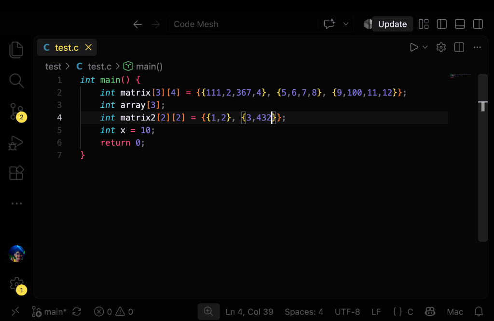
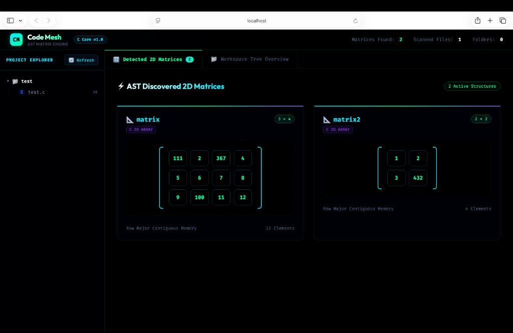
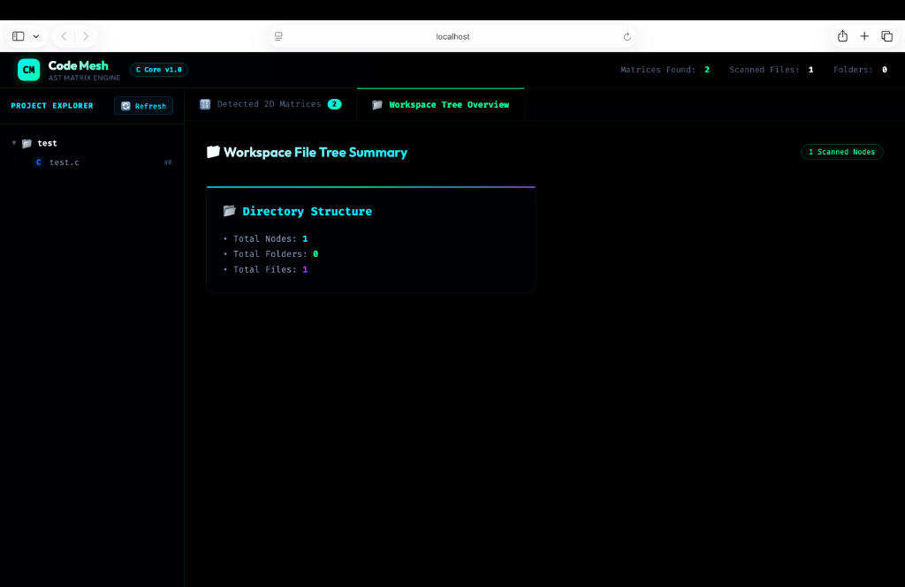

# 🌌 Code Mesh — Systems Matrix Engine & AST Code Knowledge Center

<div align="center">


<p align="center">
  <strong>A zero-dependency C Systems Engine that extracts multidimensional matrix structures directly from C source code ASTs and dynamically visualizes them in an interactive web dashboard.</strong>
</p>

</div>


---

## 📖 Introduction: What is Code Mesh?

Working with multidimensional matrices in C is notoriously difficult and opaque. In standard systems programming and numerical code (game engines, computer vision, physics simulations, DSP, embedded graphics), matrices live as raw nested arrays:

```c
double matrix[3][4] = {
    {1.0, 2.0, 3.0, 4.0},
    {5.0, 6.0, 7.0, 8.0},
    {9.0, 10.0, 11.0, 12.0}
};
```

Developers have **no visual inspection tool**, no way to verify multidimensional shapes at a glance, and no interactive map connecting memory layouts to physical data.

### 🎯 What Code Mesh Does
**Code Mesh** solves this problem from the ground up:
1. **Parses C Source Code Deterministically**: Uses the LLVM `libclang` C API to build an Abstract Syntax Tree (AST) of target C programs.
2. **Discovers Matrices Automatically**: Detects constant multidimensional arrays (`CXType_ConstantArray`), extracts their names, dimensions ($Rows \times Columns$), primitive types (`int`, `float`, `double`, `char`), and initialized literal values.
3. **Flattens into Contiguous Memory**: Allocates and packs data into contiguous Row-Major 1D buffers in RAM.
4. **Scans File System Hierarchies**: Recursively traverses project directories using native POSIX system calls.
5. **Serializes to JSON without 3rd-Party Libraries**: Writes clean, structured JSON using POSIX file descriptors (`open`, `dprintf`, `close`).
6. **Renders on an Interactive Visualizer**: Dynamically displays code matrices in mathematical bracket notation with cell-coordinate inspection.

### 💡 Engineering Philosophy
Code Mesh is grounded in **handcrafted C systems programming**. The entire core engine—AST traversal, memory allocators, pointer ownership models, POSIX directory scanner, dynamic collection structures, and custom serializer—is built purely from scratch in C11 without third-party frameworks or automated code generation. A browser-based frontend serves as a companion UI to visually interface with the engine's output.

### 🌟 Ultimate Vision: Zero-AI Code Knowledge Center
Code Mesh is growing beyond matrices. Its long-term goal is to become a complete, **zero-AI static analysis and code architecture visualizer**. It will map entire codebases—tracking function call graphs, variable data flows, folder connections, and execution paths through pure mathematical graph theory and deterministic systems engineering.

---

## 📸 Visual Demo & Live Engine Showcase

Here is Code Mesh in action—transforming raw C source code array declarations into an interactive, mathematical matrix dashboard:

### 1. Raw C Source Code with Initialized Matrices (`test/test.c`)
The target code containing constant 2D matrix definitions (`matrix[3][4]` and `matrix2[2][2]`):



### 2. AST Discovered 2D Matrices Visualizer
The dynamic web dashboard rendering the parsed matrices in high-tech bracket notation with contiguous Row-Major indexing:



### 3. POSIX Scanned Workspace Tree Overview
The project explorer sidebar and scanned directory structure summary:



---

## 🏛️ System Architecture & Components

```
                                  +-----------------------------+
                                  |     Target C Codebase       |
                                  |     (e.g., test/test.c)     |
                                  +--------------+--------------+
                                                 |
                     +---------------------------+---------------------------+
                     |                                                       |
                     v                                                       v
        +-------------------------+                             +-------------------------+
        |   POSIX Tree Scanner    |                             |    Clang AST Traversal  |
        |  (src/scanner/tree.c)   |                             |   (src/ast/ast_trav.c)  |
        |  Recursive opendir()    |                             |  CXTranslationUnit/AST  |
        +------------+------------+                             +------------+------------+
                     |                                                       |
                     |  Node Hierarchy                                       |  VarDecl Walk
                     v                                                       v
        +-------------------------+                             +-------------------------+
        |   Mesh Tree Metadata    |                             |     Matrix Detector     |
        |  (Directories & Files)  |                             |  (matrix_detector.c)    |
        +------------+------------+                             +------------+------------+
                     |                                                       |
                     |                                                       |  Matrix* Pointer
                     |                                                       v
                     |                                          +-------------------------+
                     |                                          |    Matrix Collection    |
                     |                                          |   (src/matrix/matrix.c) |
                     |                                          |   Dynamic Array Resizing|
                     |                                          +------------+------------+
                     |                                                       |
                     +---------------------------+---------------------------+
                                                 |
                                                 v
                                  +-----------------------------+
                                  |     Custom JSON Exporter    |
                                  |  (src/exporter/json_exp.c)  |
                                  |  Low-level dprintf() output |
                                  +--------------+--------------+
                                                 |
                           +---------------------+---------------------+
                           |                                           |
                           v                                           v
                  web/mesh_data.json                          web/matrix_data.json
                           |                                           |
                           +---------------------+---------------------+
                                                 |
                                                 v
                                  +-----------------------------+
                                  |      Web UI Visualizer      |
                                  |   (HTML / Vanilla CSS / JS) |
                                  |   High-Tech Bracket Grid    |
                                  +-----------------------------+
```

---

## 🧩 Deep Dive: Every Component Explained

### 1. The Clang AST Matrix Detector (`src/matrix/matrix_detector.c` & `src/ast/`)
- **AST Generation**: `clang_parseTranslationUnit` compiles target `.c` files into a Clang AST translation unit.
- **Visitor Pattern**: Walks the cursor tree with `clang_visitChildren`.
- **Target Identification**: Filters nodes for `CXCursor_VarDecl`. If the declaration type is `CXType_ConstantArray` whose element type is *also* a `CXType_ConstantArray`, a **2D Matrix** is confirmed.
- **Context Passing (`MatrixContext`)**: Because visitor callbacks in C are stateless, a `MatrixContext` struct carrying the active `Matrix*`, current `.row`, and current `.column` is passed as `CXClientData`.
- **Literal Value Evaluation**: When nested `CXCursor_InitListExpr` nodes are visited, `clang_Cursor_Evaluate` extracts the exact constant literal values (`int`, `float`, `double`, `char`) and loads them into the matrix buffer.

### 2. The Core Matrix Engine (`src/matrix/matrix.c`)
- **Contiguous Row-Major Storage**: Rather than inefficient pointer-to-pointer (`double**`) arrays with fragmented heap blocks, all data is allocated in a single contiguous memory block:
  $$\text{Index} = (\text{row} \times \text{columns}) + \text{column}$$
- **Type Safety**: Supports `MATRIX_INT`, `MATRIX_FLOAT`, `MATRIX_DOUBLE`, and `MATRIX_CHAR` via generic `void* data` with explicit `element_size`.
- **Dynamic Collection Resizing**: `MatrixCollection` implements a geometric dynamic array. When capacity is exceeded, it dynamically doubles via `realloc()`:
  $$2 \longrightarrow 4 \longrightarrow 8 \longrightarrow 16 \dots$$

### 3. POSIX Directory Tree Scanner (`src/scanner/tree_scanner.c`)
- Uses low-level POSIX filesystem APIs: `opendir()`, `readdir()`, and `lstat()`.
- Distinguishes directories from files using `S_ISDIR(st.st_mode)`.
- Recursively traverses subfolders while filtering hidden files and Apple debug symbols (`.dSYM`).

### 4. Zero-Dependency JSON Exporter (`src/exporter/json_exporter.c`)
- Eliminates heavy external libraries (like `cJSON` or `jansson`).
- Directly opens files using POSIX `open()` with flags `O_WRONLY | O_CREAT | O_TRUNC`.
- Emits formatted JSON streams via POSIX `dprintf()` into `web/mesh_data.json` and `web/matrix_data.json`.

### 5. High-Tech Visualizer Frontend (`web/`)
- Built with vanilla HTML5, modern CSS, and JavaScript (Zero external JS frameworks).
- **Mathematical Bracket Notation**: Renders matrix cards enclosed in high-tech glowing cyan brackets `[ ]`.
- **Instant Hover Tooltips**: Hovering over any matrix cell node displays an instant badge showing exact `[Row r, Col c]` coordinates.
- **Dynamic Sync**: Fetches engine JSON exports with timestamp cache-busting (`?t=Date.now()`).

---

## 🛠️ Prerequisites & Compatibility

### Operating System Compatibility
- **macOS** (Tested on Apple Silicon M-series & Intel)
- **Linux** (Ubuntu, Debian, Fedora, Arch)

### System Requirements
1. **Clang / LLVM Development Libraries** (`libclang`):
   - **macOS (Homebrew)**:
     ```bash
     brew install llvm
     ```
   - **Linux (Ubuntu / Debian)**:
     ```bash
     sudo apt-get install libclang-dev clang llvm
     ```
2. **GCC or Clang Compiler**: Standard C11 compiler.
3. **Python 3**: Used solely to host the local web server (`python3 -m http.server`).

---

## 🚀 How to Run (Step-by-Step)

### Option 1: The All-in-One Runner (Recommended)
We provide an automated script that compiles the C engine, runs the AST parser on the `test` directory, exports the JSON files, and opens the visualizer in your browser:

```bash
./run.sh
```
*(Or run `make start`)*

---

### Option 2: Step-by-Step Manual Execution

#### 1. Compile the C Systems Engine
```bash
make clean
make
```
This builds the unified `codemesh_engine` binary, linking against `libclang`.

#### 2. Run Matrix Detection on Target Directory
```bash
./codemesh_engine test
```
**Console Output:**
```
==========================================
        Code Mesh — C Systems Engine      
==========================================

--> Scanning directory tree: test...
--> Exporting 1 nodes to web/mesh_data.json...

--> Analyzing C source files for 2D matrices...
    Parsing: test/test.c
Detected 2D Matrix: matrix [3 x 4]
Matrix Created successfully !!
 Name : matrix
 Rows : 3
 Columns : 4
Detected 2D Matrix: matrix2 [2 x 2]
Matrix Created successfully !!
 Name : matrix2
 Rows : 2
 Columns : 2
--> Total matrices discovered: 2 (stored in collection)
--> Exporting matrices to web/matrix_data.json...
--> Success! Code Mesh pipeline complete.
```

#### 3. View in Browser
Open `http://localhost:8080` in your web browser:
```bash
python3 -m http.server 8080 --directory web
```

---

## 🧠 What I Learnt: Deep Systems Programming Insights

Building Code Mesh from scratch has been an intensive journey in C systems programming and memory architecture. Here are the core technical concepts I mastered:

### 1. Pointer Semantics & The "Dangling Pointer" Trap
- **The Problem**: When extracting variable names from `libclang`, `clang_getCString(nameStr)` returns a pointer to temporary memory owned by `CXString`. Storing `matrix->name = name` only copied the **8-byte address number**, not the string characters. Calling `clang_disposeString(nameStr)` immediately demolished that memory, turning `matrix->name` into a **dangling pointer** that printed garbage like `" %b  "`.
- **The Solution**: Mastered deep memory ownership. Used `strdup()` to allocate an independent heap block in RAM for the string, ensuring the matrix owns its data.

### 2. Contiguous Memory vs Pointer Arrays
- Learned why production numerical engines do NOT use `double**` (pointer to array of pointers). Fragmented pointers cause cache misses in CPU L1/L2 caches.
- Implemented **Row-Major Contiguous Storage** (`rows * cols * element_size`), mapping 2D coordinates `[row][col]` to a flat index `(row * cols) + col`.

### 3. State Preservation in Stateless Visitor Callbacks
- `libclang`'s AST traversal is recursive and stateless. Callbacks cannot store internal variables across invocations.
- Solved this by creating a dedicated `MatrixContext` struct and passing its pointer through `CXClientData` (`client_data`). This maintained persistent row/column counters as libclang recursively visited nested initializer lists.

### 4. Dynamic Collections & Geometric Growth
- Built a dynamic collection from scratch using `malloc` and `realloc`.
- Mastered the doubling strategy ($2 \to 4 \to 8$) to achieve $O(1)$ amortized insertion time instead of expensive reallocations on every addition.

### 5. Low-Level POSIX System Calls
- Replaced standard high-level library functions with raw POSIX syscalls:
  - `opendir`, `readdir`, `closedir`, and `lstat` for filesystem traversal.
  - `open`, `dprintf`, and `close` with file descriptors for zero-dependency JSON serialization.

---

## 🔮 Upcoming Roadmap: The Future of Code Mesh

Code Mesh is currently an active working prototype. Here is what is being engineered next:

### 1. Pure C POSIX Web Server (In Progress)
- **Goal**: Eliminate Python's `http.server` entirely.
- **Implementation**: Write a zero-dependency HTTP server in C using `<sys/socket.h>` (`socket`, `bind`, `listen`, `accept`).
- **Feature**: Enable users to select or type a directory directly in the frontend UI. The browser sends a `POST /scan` request, and the C server parses the codebase in real-time without restarting or recompiling the binary.

### 2. Advanced AST & Mathematical Expression Parsing
- **Expressions as Matrix Elements**: Detect non-literal expressions inside matrix brackets (e.g., `matrix[2][2] = {{x + 1, cos(y)}, {arr[0], func()}}`) using AST expression evaluation.
- **Runtime Matrix Tracking**: Detect dynamically allocated matrices created via `malloc(rows * cols * sizeof(double))`.
- **N-Dimensional Tensors**: Expand detection beyond 2D to support **1D vectors, 3D tensors, and 4D hyperspaces** dynamically.

### 3. Core Matrix Linear Algebra Engine
- Interactive frontend cell editing with bi-directional synchronization back to C.
- Mathematical operations implemented in C:
  - Matrix Multiplication ($A \times B$)
  - Matrix Transposition ($A^T$)
  - Inversion ($A^{-1}$) & Determinants ($\det(A)$)
  - Eigenvalue / Eigenvector decomposition

### 4. Complete Code Knowledge Center (No AI, Pure Static Analysis)
- **Function Call Graphs**: Map caller/callee relationships across files.
- **Variable Lifecycle Visualizer**: Track where variables are declared, mutated, and freed.
- **Code Execution Flow**: Step-by-step interactive diagram of how code executes through functions and modules.

---

## 📂 Project Structure

```
Code Mesh/
├── Makefile                    # Unified compilation & test targets
├── README.md                   # Comprehensive project documentation
├── run.sh                      # All-in-one build, scan, & web visualizer script
├── include/                    # Public C Header Definitions
│   ├── ast/
│   │   └── ast_traversal.h     # libclang AST analyzer interface
│   ├── exporter/
│   │   └── json_exporter.h     # POSIX JSON serialization headers
│   ├── matrix/
│   │   ├── matrix.h            # Matrix & MatrixCollection structures
│   │   └── matrix_detector.h   # AST 2D matrix detector interface
│   └── scanner/
│       └── tree_scanner.h      # POSIX directory scanner header
├── src/                        # C Systems Implementation
│   ├── main.c                  # Unified pipeline entry point
│   ├── ast/
│   │   └── ast_traversal.c     # libclang AST traversal & visitor
│   ├── exporter/
│   │   └── json_exporter.c     # Low-level dprintf() JSON serializer
│   ├── matrix/
│   │   ├── matrix.c            # Contiguous memory & dynamic collections
│   │   └── matrix_detector.c   # AST array and literal extraction
│   └── scanner/
│       └── tree_scanner.c      # POSIX opendir/readdir recursive scanner
├── test/
│   └── test.c                  # Sample C code containing initialized matrices
└── web/                        # Web Visualizer Dashboard (HTML5 / Vanilla CSS & JS)
    ├── index.html              # Modern IDE layout & tabs
    ├── style.css               # Dark theme, glassmorphic cards, math brackets
    ├── app.js                  # Dynamic JSON data fetcher & DOM renderer
    ├── matrix_data.json        # Live exported matrix data
    └── mesh_data.json          # Live exported workspace tree
```

---

<div align="center">
  <sub>Built with passion for low-level systems programming by <strong>Kaushal</strong>.</sub>
</div>
